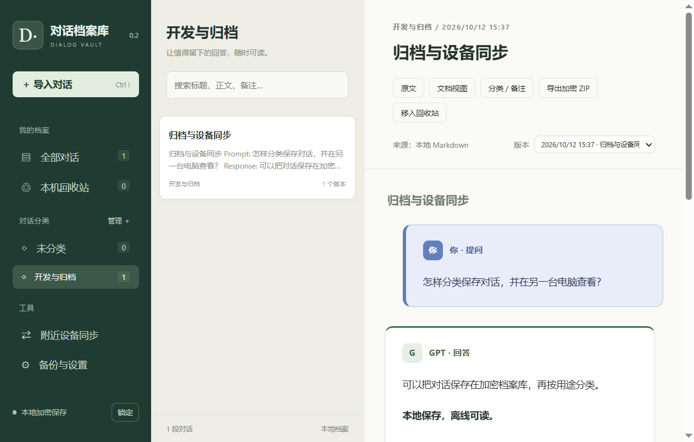

# 对话档案库 · Dialog Vault

Windows 本地对话归档应用。把 Codex / ChatGPT 导出的 Markdown 保存到加密档案库，离线阅读、搜索、分类，并在局域网内增量同步。

当前版本：**0.2.0**。使用 Electron；安卓端尚未实现。



## 功能

- 剪贴板 / Markdown 文件导入，完整保留原始 Markdown。
- 表格、代码高亮与复制、公式、本地图片和折叠过程记录。
- 提问与回答区块；支持明确的 Prompt / Response 标记及 Codex 导出格式。
- 对话分类、备注、搜索、历史版本、本机回收站与阅读位置恢复。
- AES-256-GCM 本地加密，打开密码、恢复密钥及自动锁定。
- 自动发现局域网设备，首次允许连接后记住配对，点击即可双向增量同步。
- AES-256 加密 ZIP 导出，默认使用软件打开密码；支持合并恢复。

## 本地运行

需要 Node.js **22.12 或更高版本**及 npm。桌面客户端当前只针对 Windows 验证。

```sh
npm ci
npm start
```

安装依赖时会自动生成离线阅读资源 `vendor/`，不从 CDN 加载脚本。首次运行 Electron 如需下载运行时，请保持网络连接。

## 打包 Windows 版本

在 Windows 电脑上运行：

```sh
npm run build:win
```

结果位于 `dist/DialogVault-PC-0.2.0/`，双击 `DialogVault.exe`。DLL、`resources` 等须与 EXE 一起保留。此构建输出为便携文件夹，尚未提供代码签名或自动更新。

## 导入与分类

1. Codex 对话列表 → 右键 → 复制 → 复制为 Markdown。
2. App → 导入对话 → 从剪贴板粘贴 → 预览 → 保存。
3. 新增内容时选择“更新已有档案”，保留为新版本。
4. 左侧分类管理可创建、改名和删除分类；分类删除不删除对话。

角色识别只影响阅读视图，不改写原文。无法可靠识别的文档保留普通 Markdown 阅读，也可切换文档视图 / 原文。

## 局域网同步

两台 Windows 电脑都运行本 App 并解锁，连接同一局域网。在“附近设备同步”点击对方，首次核对连接码并在接收端允许连接，之后点击即可同步。

- 发现：IPv4 UDP 47832，广播及组播。
- 数据：TCP 47831，X25519 配对密钥协商与 AES-256-GCM 加密。
- 按缺少的完整档案版本及分类变更合并，不替换整个库。
- 回收站和阅读位置仅保存在本机。
- 路由器设备隔离或防火墙可能阻止发现；仅允许自己的专用网络。

## 本地加密与导出

正文、标题、分类、备注、图片及历史版本统一加密保存到 `archive.vault`。具体目录在“备份与设置”查看。密码经 scrypt 派生密钥保护随机数据密钥；不保存明文密码或明文搜索索引。

加密 ZIP 包含 `archives.json`（全部所选版本与元数据）和 `documents/`（最新版本 Markdown 与图片）。可在本 App 合并恢复，也可用支持 AES ZIP 的工具解压。修改打开密码不改变旧 ZIP 的密码。用恢复密钥解锁时须另设 ZIP 密码。

原始 .md 文件、系统剪贴板及主动导出的明文 .md 不由本 App 自动加密。请自行妥善保管恢复密钥及备份。

## 测试

```sh
npm test                 # 11 项核心单元/协议测试
npm run test:network     # 本机网络发现和配对集成测试，需要可用的局域网接口
npm run test:ui          # 基础桌面流程
npm run test:features    # 分类、ZIP 和双桌面实例同步
npm run test:upgrade     # 0.1 格式兼容性
```

桌面测试使用临时测试档案及测试密码，不读取正式档案。网络集成测试需要 Windows / 路由器允许本地广播或组播。

## 已验证范围及限制

0.2 交付版本通过 12 项核心/网络测试、桌面流程、两独立实例同步及 0.1 档案升级验证。加密 ZIP 通过独立 7-Zip 正确密码 / 错误密码检查。

两实例验证在同一台电脑完成，不代表所有物理设备、路由器及防火墙环境已通过。未进行独立安全审计和长期压力测试。

目前不支持安卓、官方 ChatGPT ZIP/JSON 导入、消息级自动拼接、非图片附件、附件分块续传。单份 Markdown 10 MB、单张图片 5 MB、单次图片合计约 25 MB；同步报文 64 MB，档案版本上限 20000。本机保存仍重写加密文件，超大档案性能待优化。

## 目录

| 文件 | 用途 |
| --- | --- |
| `main.js` / `preload.js` | 桌面窗口、系统接口与隔离的 IPC |
| `core.js` | 本地加密、版本与分类合并 |
| `network.js` / `sync.js` | 设备发现、配对及加密同步 |
| `conversation.js` | 阅读视图角色分段 |
| `zip-export.js` | 加密 ZIP 导出与合并恢复 |
| `renderer.js` / `index.html` / `style.css` | 档案库界面 |
| `scripts/` | 离线资源生成、Windows 打包 |
| `tests/` | 核心、网络、桌面及兼容性测试 |

项目源码许可证尚未指定。第三方依赖的许可证见 [THIRD_PARTY_NOTICES.md](THIRD_PARTY_NOTICES.md)。
